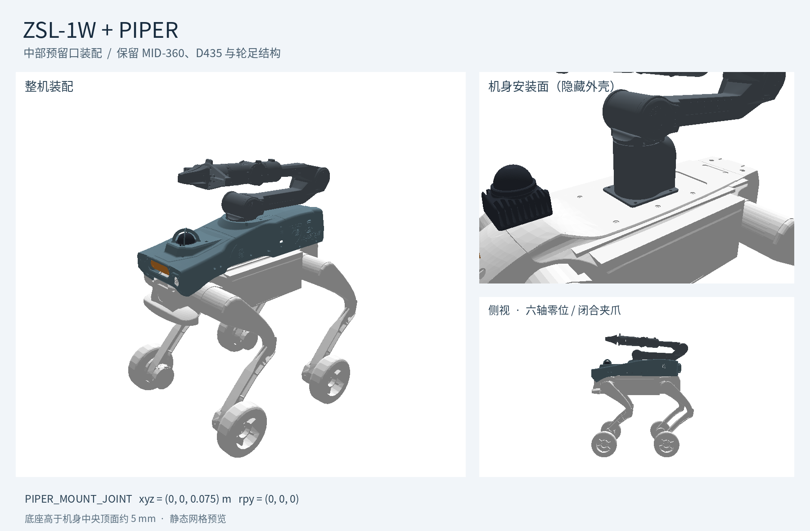

# ZSL1_W 轮足机器人



训练任务：`RobotLab-ZSL1W-Piper-Fixed-v0`，算法：MoE-CTS。

## URDF 目录

[resources/zsl1w/urdf/](resources/zsl1w/urdf/)

## Checkpoint 目录

已上传的模型和训练参数直接保存在原训练目录，克隆仓库后即可使用：

[logs/rsl_rl/zsl1w_piper_fixed_moe_cts/2026-11-05_11-41-01_zsl1w_v1/](logs/rsl_rl/zsl1w_piper_fixed_moe_cts/2026-11-05_11-41-01_zsl1w_v1/)

```text
logs/rsl_rl/zsl1w_piper_fixed_moe_cts/2026-11-05_11-41-01_zsl1w_v1/
├── model_10000.pt
├── model_20000.pt
└── params/
    ├── agent.yaml
    └── env.yaml
```

下面使用 `model_20000.pt`，也可替换为 `model_10000.pt`。

## 配置环境

1. 创建 Python 3.11 环境并安装 Isaac Lab：

```bash
conda create -n wf_cts_moe python=3.11
conda activate wf_cts_moe
pip install --upgrade pip
pip install "isaaclab[isaacsim,all]==2.3.2.post1" --extra-index-url https://pypi.nvidia.com
pip install -U torch==2.7.0 torchvision==0.22.0 --index-url https://download.pytorch.org/whl/cu128
```

2. 克隆本项目，以可编辑模式安装定制版 RSL-RL 和 robot_lab：

```bash
git clone https://github.com/aimer0222/legbot_lab_zsibot.git
cd legbot_lab_zsibot
python -m pip install -e source/robot_lab
python -m pip install -e source/rsl_rl
```

已有本地仓库时，直接进入项目根目录执行两条安装命令即可。

3. 安装 MuJoCo（可选，用于 Sim2Sim）：

```bash
pip install mujoco pygame
```

后续训练和播放命令均在已激活的 `wf_cts_moe` 环境、项目根目录执行。示例使用 `cuda:0`，可替换为实际使用的 GPU。

> 注：也可以参考[原项目的 README（中文）](README_UPSTREAM_CN.md#安装步骤)进行环境配置。

## 从头训练

```bash
python scripts/rsl_rl/train.py \
  --task RobotLab-ZSL1W-Piper-Fixed-v0 \
  --headless \
  --device cuda:0 \
  --num_envs 4096 \
  --max_iterations 50000 \
  --run_name zsl1w_scratch
```

不加 `--resume` 即从头训练。显存不足时降低 `--num_envs`。

## 继续训练

直接从已上传的 `model_20000.pt` 续训，无需复制模型或建立恢复目录：

```bash
python scripts/rsl_rl/train.py \
  --task RobotLab-ZSL1W-Piper-Fixed-v0 \
  --headless \
  --device cuda:0 \
  --num_envs 4096 \
  --resume \
  --load_run 2026-11-05_11-41-01_zsl1w_v1 \
  --checkpoint model_20000.pt \
  --max_iterations 30000 \
  --run_name zsl1w_resume
```

续训时 `--max_iterations 30000` 表示额外训练 30000 次更新。新训练和续训均输出到 `logs/rsl_rl/zsl1w_piper_fixed_moe_cts/<时间戳>_<run_name>/`，默认每 50 次迭代保存 checkpoint。

## Play 可视化

在支持图形显示的会话中执行：

```bash
python scripts/rsl_rl/play.py \
  --task RobotLab-ZSL1W-Piper-Fixed-v0 \
  --load_run 2026-11-05_11-41-01_zsl1w_v1 \
  --checkpoint model_20000.pt \
  --device cuda:0 \
  --num_envs 16 \
  --terrain_level 6 \
  --real-time
```

不加 `--headless` 即打开仿真窗口。`--terrain_level` 可设为 0～9；增加 `--fix_commands` 可固定向前速度为 `1.0 m/s`。

无图形界面时，在同一命令末尾增加 `--headless --video --video_length 500` 录制视频，结果保存在该运行目录的 `videos/play/` 下。
