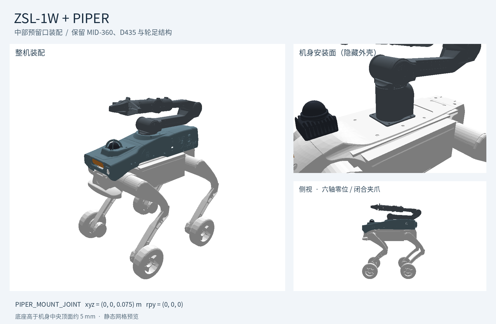

# ZSL-1W 巡检平台 + PIPER

导入文件：`../urdf/zsl1w_inspection_piper.urdf`。该文件是新增的装配版，原 `zsl1w_inspection.urdf` 和 ZSL-1 模型不变。



## 安装位置

机械臂固定在上装中部预留开口，安装链为：

```text
BASE_LINK
├── PAYLOAD_HOUSING_JOINT → PAYLOAD_HOUSING
└── PIPER_MOUNT_JOINT → piper_base_link
    └── piper_joint1 … piper_joint6 → 法兰、夹爪
```

`PIPER_MOUNT_JOINT` 为固定关节，直接连接机器狗机身 `BASE_LINK`。相对位姿为 `xyz="0 0 0.075"`、`rpy="0 0 0"`，距离单位米，角度单位弧度。机身 X 朝前、Y 朝左、Z 朝上；PIPER 的 +X 朝前，底座接线端朝后。

机械臂底面以机器狗本体为安装基准。中央机身顶面约为 `Z=0.07003 m`，底座放在 `Z=0.075 m`，高出约 **5 mm**，并下沉在外壳内部。XY 与朝向保持原样；相较初版 `Z=0.16544 m` 下移了 **90.44 mm**。此处没有增加转接板、安装螺栓或对应质量。

装配版把封住中央空腔的两块简化外壳碰撞盒分成 8 块，在 `X=[-0.065,0.045] m`、`Y=[-0.045,0.045] m`、`Z=[0.06,0.175] m` 范围留空；外壳视觉网格、质量惯量和原始模型文件不变。该碰撞代理开口只处理原有粗略包络，不代表已修改 CAD。

**外观网格核对：** 六轴零位的水平切片检查发现，机械臂第一连杆与外壳口沿在约 `Z=0.163–0.1654 m` 有局部毫米级干涉。当前保留原外壳外观网格；若需要用于实体装配，应局部扩大口沿，并按实际支架重新校准。该检查不覆盖机械臂全行程。右上预览隐藏外壳以显示底座与机器狗机身的关系。

PIPER 来自仓库中 `Robots/piper/urdf/piper_with_gripper_description.urdf`，其网格也由同级 `Robots/piper/meshes/` 提供。`Unitree/go2/usd/go2_piper.usd` 是已有的 Go2 装配，不作为 ZSL-1W 的底盘来源。移动模型包时，请保留 `Robots/Unitree/zsl1w/` 与 `Robots/piper/` 的相对层级；所有网格引用均为相对路径。

## 关节与动力学数据

- 原轮足平台的 16 个活动关节、MID-360、D435 和光学坐标系均保留。
- 新增的机械臂连杆和关节统一加 `piper_` 前缀，例如 `joint1` 对应 `piper_joint1`。
- 六轴关节为 `piper_joint1` 至 `piper_joint6`，保留源 URDF 的关节轴、限位、力矩、速度、质量和惯量。
- `piper_gripper` 为夹爪虚拟开度驱动，范围为 0～0.1 m；两指 `piper_gripper_joint1/2` 分别以 `+0.5/-0.5` 倍率跟随，保留源文件的 mimic 定义。
- 移除了机械臂原有的 `world` 和 `world_to_base_link`，整机只有一个 `BASE_LINK` 根，机械臂随移动底盘运动。

整机共 35 个连杆、34 个关节，其中 25 个活动关节含 2 个 mimic 从动关节，共 23 个独立活动关节（轮足 16 + 机械臂 6 + 夹爪 1）。声明质量为 **26.329130015 kg**，其中原巡检平台为 21.629130015 kg，PIPER 含夹爪为 4.7 kg。

质量统计来自 URDF 的显式质量；源模型中的无实体光学 frame 和 PIPER 虚拟夹爪驱动 link 未补造惯量。静态预览导入器对这些空 link 的默认质量不作为动力学验证结果。

## 在 Isaac Sim 中导入

1. 使用 URDF Importer 打开 `urdf/zsl1w_inspection_piper.urdf`，选择移动/浮动基座，启用 URDF 惯量，保持根节点未固定到世界。
2. 关闭 Merge Fixed Joints，以便保留上装、机械臂底座和传感器坐标系；启用解析 mimic joints。若使用的导入器不支持 mimic，控制器需显式实施两个夹指的跟随关系。
3. 沿用 URDF 已有碰撞体，避免从整个外壳视觉网格生成单一凸包封住安装口。固定连接的底座和机身按相邻连杆处理，外壳中央的碰撞代理已留空；接触膨胀距离仍需在实际导入器中核对。
4. 四个 `*_FOOT_JOINT` 是轮子，按原轮足模型配置速度驱动；机械臂、夹爪和腿部按各自控制器配置。URDF 装配文件本身不包含 Isaac Lab 执行器或训练任务配置。
5. 机械臂预览使用六轴零位和闭合夹爪。预览中的腿部姿态仅用于展示。实际启动时应显式设置合法腿部角度，例如髋部 0.7 rad、膝部 -1.4 rad；膝部零位超出源模型限位。

装配后机械臂会改变雷达的后向遮挡，原模型的传感器遮挡统计不能直接用于本模型；原有传感器配置与安装变换保持不变。

## 重新生成与检查

从 `legged_lab/` 目录执行（仅使用 Python 标准库）：

```bash
python3 scripts/tools/assemble_zsl1w_piper.py
python3 scripts/tools/validate_zsl1w_piper.py
```

调整安装位置时，修改 `configuration/piper_mount.json` 的 `xyz_m` 和 `rpy_rad`，再执行上述两条命令。预览 PNG 为当前名义位姿的静态快照，修改位姿后不会自动更新。

当前检查记录见 `piper_validation.json`：XML 关节树、唯一浮动根、全部 42 个网格引用、原机定义保留（仅装配版外壳碰撞体留空）及机械臂源定义保留、夹爪 mimic 引用、关节限位、31 个显式惯量的正定性和整机质量均通过。已使用 PyBullet DIRECT 成功静态导入并生成装配预览；未执行 Isaac Sim 动力学、机械臂全工作空间干涉、步态或传感器出数验证。
